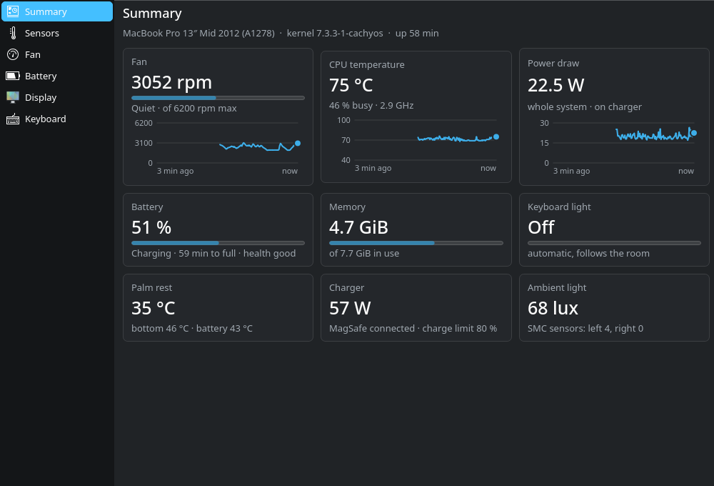
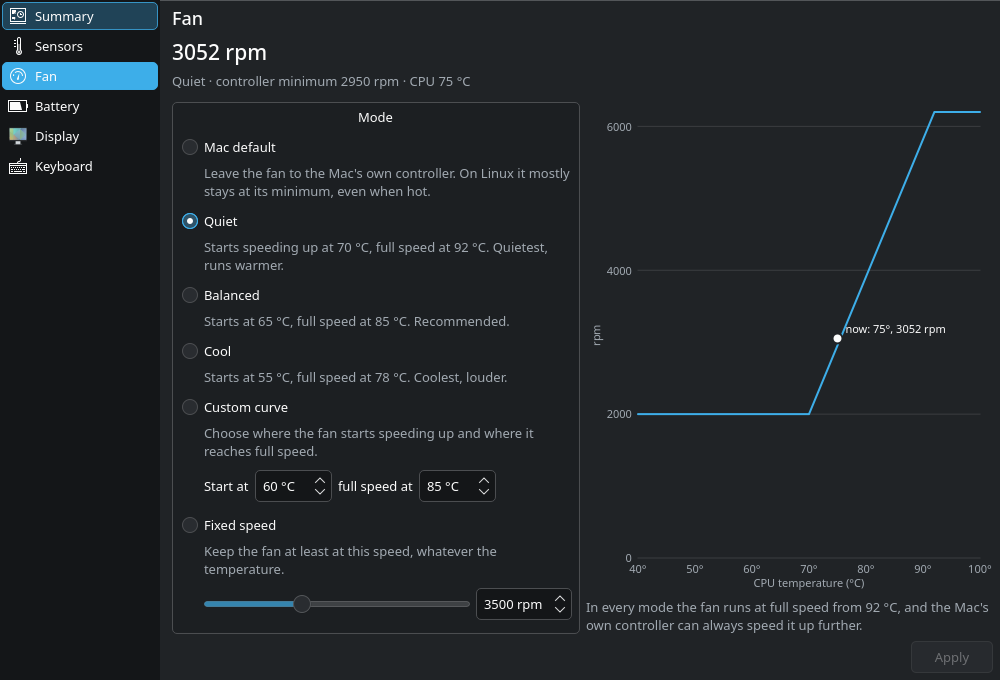
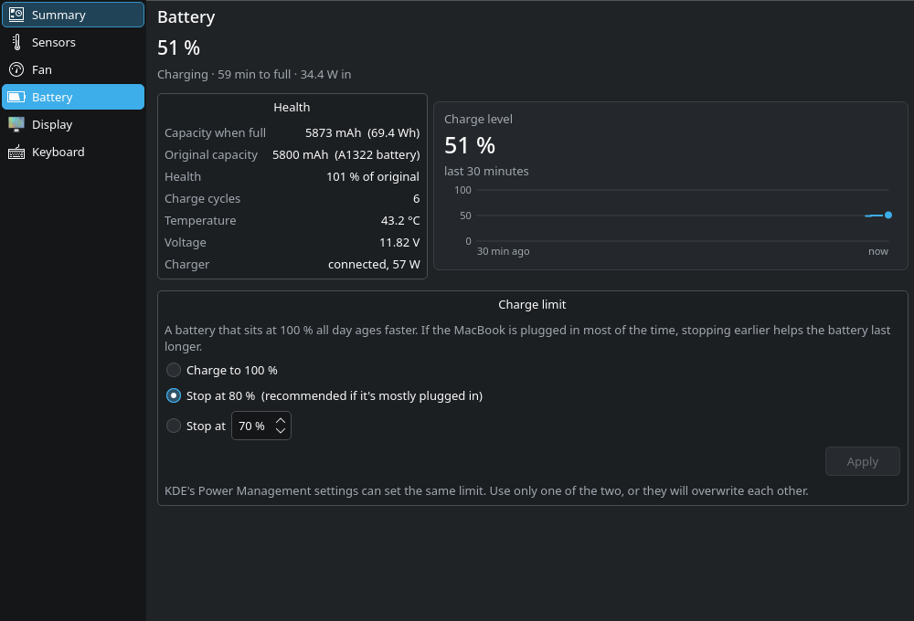
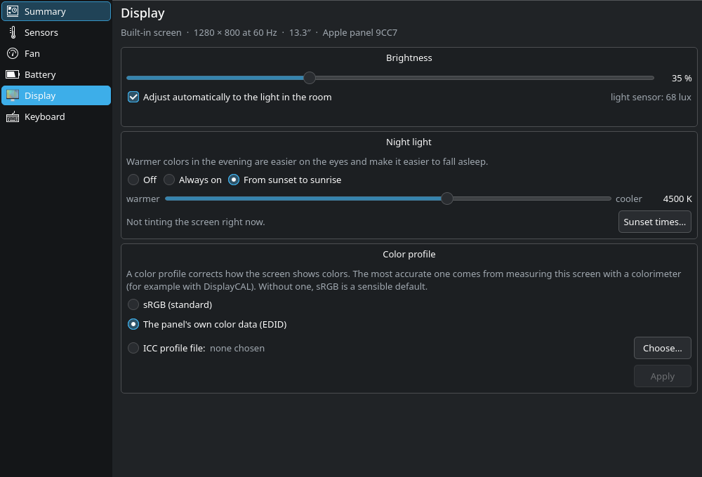
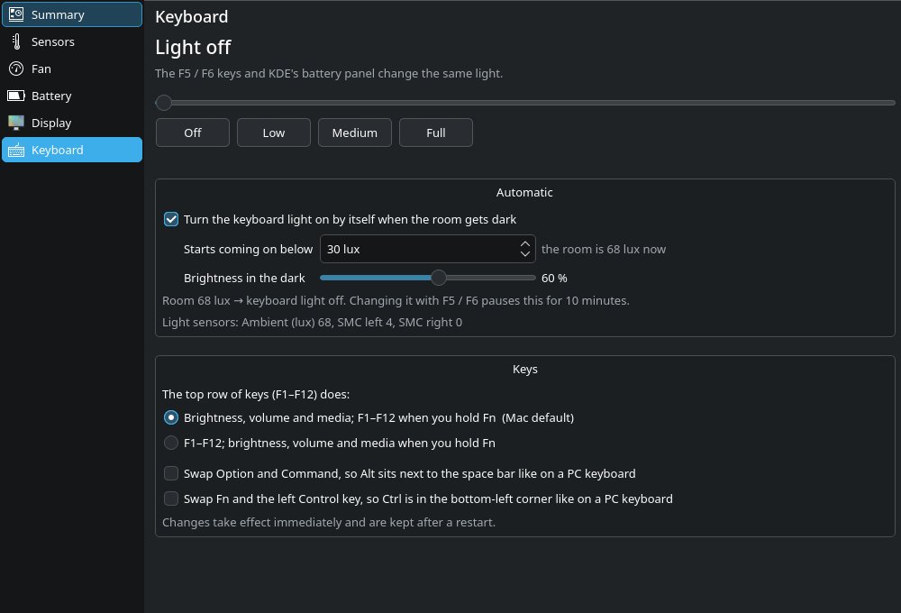

# Intel MacBook Control

**Fan control, sensors, battery charge limit, keyboard light and display settings for pre-2018 Intel
MacBooks on CachyOS kernel 7.3+ with KDE Plasma — plus a native-looking Qt app to manage it all.**



> Built for and tested on a **MacBook Pro 13″ Mid 2012** (A1278, `MacBookPro9,2`). Other Intel Macs
> without a T2 chip may work, but are untested. Please report your results.

## Why this exists

Older Intel MacBooks have an SMC chip that controls the fan and reads the sensors. On Linux, that used to be
handled by the `applesmc` driver. With **linux-cachyos 7.3**, that stopped working:

1. **`applesmc` is no longer built.** The kernel now has a new `macsmc` driver family, and its Kconfig makes
   the two mutually exclusive (`MACSMC_ACPI depends on !SENSORS_APPLESMC`). CachyOS builds `macsmc`.
2. **`macsmc` has no fan control on these Macs.** Its hwmon driver exposes temperatures, power, current and
   voltage, but no fan controls, so tools like `mbpfan` can't work. On Linux the SMC then leaves the fan at its
   minimum: on this MacBook the CPU went from 71 °C to **96 °C in 60 seconds while the fan stayed at 2000 rpm**.
3. **The keyboard backlight is invisible to KDE.** `macsmc` names the LED `macsmc-led`, but UPower only
   recognises LEDs whose name contains `kbd_backlight`, so F5/F6 and KDE's slider stop working.
4. **From 7.3.3 there's no SMC driver at all.** `macsmc-acpi`'s probe now refuses Macs without a T2 chip:
   it checks `has_apple_t2_chip` and returns `-ENODEV`, silently. That means no fan control, no sensors, no
   keyboard light and no SMC battery driver.

The LTS kernel (6.18) still ships `applesmc`, so booting it plus `mbpfan` is a working fallback. This
project lets you stay on the current kernel instead.

## What it does

| | |
|---|---|
| **Fan control** | `smcfan` drives the fan through the new driver's `/dev/smc` interface. Six modes: Mac default, Quiet, Balanced, Cool, Custom curve, Fixed speed. Result on this MacBook: **80–82 °C under full load instead of 96 °C**, with no throttling. |
| **Keyboard light** | `smckbd` creates an LED called `smc::kbd_backlight` (through the kernel's `uleds` driver) and mirrors it to the real one, so F5/F6, KDE's slider and UPower work again. |
| **Automatic keyboard light** | `macbook-kbdlight` reads the ambient light sensor and fades the keyboard light on in the dark and off in daylight. It backs off for 10 minutes when you change the light yourself. |
| **Battery** | Health and capacity against the original design, plus a **charge limit** (e.g. stop at 80 %), re-applied at every boot. |
| **Keyboard keys** | F1–F12 or media keys first, swap Option⇄Command, swap Fn⇄left Ctrl (Apple keyboard driver options, kept across reboots). |
| **Display** | Brightness, automatic brightness from the light sensor, night light with live preview, color profile (sRGB / EDID / ICC). All of it goes through KDE, no root needed. |
| **7.3.3+ driver fix** | `macbook-smc-patch` removes only the T2 check from each kernel's stock `macsmc-acpi` module. A pacman hook re-applies it after every kernel update. See [the driver patch](#the-driver-patch-for-pre-t2-macs). |
| **The app** | Six pages: Summary, Sensors (all ~50 SMC readings), Fan, Battery, Display, Keyboard. Uses your KDE theme, light or dark. |

| Fan | Battery | Display | Keyboard |
|---|---|---|---|
|  |  |  |  |

## Requirements

- CachyOS (or Arch) with **linux-cachyos 7.3+** and **KDE Plasma 6** (Wayland tested)
- `python` and **`pyside6`** (for the app): `sudo pacman -S pyside6`
- `zstd`, `systemd`, `polkit`, `upower`, `kscreen` (`kscreen-doctor`), `kconfig` (`kwriteconfig6`), all part of a normal CachyOS KDE install
- Unsigned kernel modules must be allowed (`cat /sys/module/module/parameters/sig_enforce` → `N`, the CachyOS default) for the 7.3.3+ driver fix
- Optional, for the LTS-kernel fallback: [`mbpfan`](https://github.com/linux-on-mac/mbpfan) (`paru -S mbpfan-git`)

## Install, update, remove

```bash
git clone https://github.com/Zgn-Bhr/intel-macbook-control.git
cd intel-macbook-control
sudo bash install.sh              # install or update everything, then open "MacBook Control" from the app menu
sudo bash install.sh uninstall    # remove it again (your settings in /etc/macbook-control are kept)
```

The installer copies everything to `/usr/local`, `/etc/systemd` and `/etc/pacman.d/hooks`. It also patches and
loads the SMC driver if needed, then starts the services. Nothing goes into `/usr/bin`, and no pacman package
files are changed.

## How the fan control stays safe

- smcfan **never switches the fan to manual mode**. It only raises the SMC's *minimum* fan speed (`F0Mn`), so
  the Mac's own controller keeps running underneath and can always spin the fan faster.
- In every mode the fan goes to **full speed from 92 °C**, or whenever the temperature can't be read.
- When smcfan stops, crashes or the system shuts down, the original minimum is restored. The original is
  kept in `/run`, so a crash can't make a raised value stick.
- Before writing anything, it checks that the fan's limits decode to sane values (e.g. 2000–6200 rpm).

## The driver patch for pre-T2 Macs

On linux-cachyos 7.3.3 the probe of `macsmc-acpi` starts like this:

```
mov    $0xffffffed,%eax                 ; -ENODEV
cmpb   $0x1, has_apple_t2_chip(%rip)
jne    <return>                         ; no T2 chip -> refuse
```

`macbook-smc-patch` replaces that one `jne` with a NOP of the same length (`66 0f 1f 44 00 00`). The rest of
the driver is untouched. It:

- **finds the check by its relocation** against `has_apple_t2_chip`, by parsing the module's ELF symbol and
  relocation tables, so it doesn't depend on fixed offsets;
- **patches only the exact expected instructions** (`cmpb $1` + `jne`, or `cmpb $0` + `je`). Anything else is
  refused, the stock driver is kept, and the reason is written to `/var/lib/macbook-control/smc-patch.status`
  (the app's Fan page shows it);
- removes the module's appended signature, which no longer matches. That's why `sig_enforce` must be off;
- writes the result to `/usr/lib/modules/<kernel>/updates/macsmc-acpi.ko`, which `modprobe` prefers over the
  stock file. The pacman package's own file is never modified;
- runs from two pacman hooks after every kernel install or upgrade, and cleans up when a kernel is removed.

Verify it yourself:

```bash
macbook-smc-patch --check /usr/lib/modules/$(uname -r)/kernel/drivers/platform/x86/macsmc-acpi.ko.zst
objdump -d -r -j .text /usr/lib/modules/$(uname -r)/updates/macsmc-acpi.ko | grep -A2 has_apple_t2_chip
sudo macbook-smc-patch --uninstall        # back to the stock driver
```

On this MacBook the patched 7.3.3 driver initialises normally ("Successfully Initialized (374 keys)"), the
same as the unmodified 7.3.1 driver, which had no T2 check.

## Permissions and security

- **The app runs as your user.** Changing the fan mode, charge limit or key options goes through `pkexec`.
  Two polkit rules (`org.macbookcontrol.smcfan.set`, `org.macbookcontrol.settings.set`) let the active desktop
  user do this without a password.
- **The helpers only do what they're asked.** Started through pkexec, `smcfan` only accepts `set` and
  `status`, and `macbook-settings` validates every value (charge limit 50–100 %, fixed word lists for the keys).
- **The services are sandboxed by systemd** (`ProtectSystem=strict`, `PrivateNetwork`, `NoNewPrivileges`,
  device allow-lists). Display and keyboard-light settings need no root at all.

## Files

| File | Installed as | Runs as |
|---|---|---|
| `smcfan.py` | `/usr/local/bin/smcfan`, started by `90-smcfan.rules` when `/dev/smc` appears | root (systemd) |
| `smckbd.py` | `/usr/local/bin/smckbd`, started by the same rule | root (systemd) |
| `macbook-settings.py` + `.service` | `/usr/local/bin/macbook-settings`; the service re-applies the settings at boot | root |
| `macbook-kbdlight.py` + `.service` | `/usr/local/bin/macbook-kbdlight`, user service in `/etc/systemd/user/` | your user |
| `macbook-smc-patch.py` + `75-macbook-smc-patch*.hook` | `/usr/local/bin/macbook-smc-patch`, `/etc/pacman.d/hooks/` | root (pacman) |
| `org.macbookcontrol.*.policy` | `/usr/share/polkit-1/actions/` | – |
| `gui/` + `macbook-control.desktop` | `/usr/local/share/macbook-control`, launcher `macbook-control` | your user |

Settings: `/etc/macbook-control/fan.json`, `/etc/macbook-control/settings.json`,
`~/.config/macbook-control/kbdlight.json`. Live state: `/run/smcfan.status`.

## Troubleshooting

```bash
cat /run/smcfan.status                              # live fan state
cat /var/lib/macbook-control/smc-patch.status       # driver fix result per kernel
journalctl -k -b | grep macsmc                      # did the SMC driver start?
journalctl -b -u smcfan -u smckbd -u macbook-settings
sudo macbook-smc-patch --reload                     # re-apply the driver fix and load it now
sudo smcfan status                                  # raw SMC fan and temperature keys
macbook-settings show                               # charge limit and key options
```

- **The fan stops after a kernel update:** check the patch status. If a new kernel's driver code changed,
  the fix refuses to guess. Boot the LTS kernel, where `mbpfan` takes over automatically, until this project
  is updated.
- **Your battery shows up twice** (`BAT0` and `macsmc-battery`): this happens when the SMC driver was loaded
  after boot. It goes away after a reboot.
- `smcfan` uses ioctls from `include/linux/mfd/macsmc.h`, which is **not a stable kernel interface**. If it
  changes, smcfan exits and the Mac's own fan control takes over.

## The real fix

All of this works around a gap in the kernel configuration. For pre-T2 Intel Macs the proper fix is in
linux-cachyos (or upstream): **build `applesmc` for Macs without a T2 chip, or let `macsmc-acpi` support them
again.** If you're affected, please mention it to the CachyOS team.

## License

GPL-3.0-or-later, see [LICENSE](LICENSE). Not affiliated with Apple, CachyOS or KDE; "MacBook" is a trademark
of Apple Inc. **Use at your own risk**: this changes how a kernel driver and your fan behave. It was written
carefully and tested on one machine.
